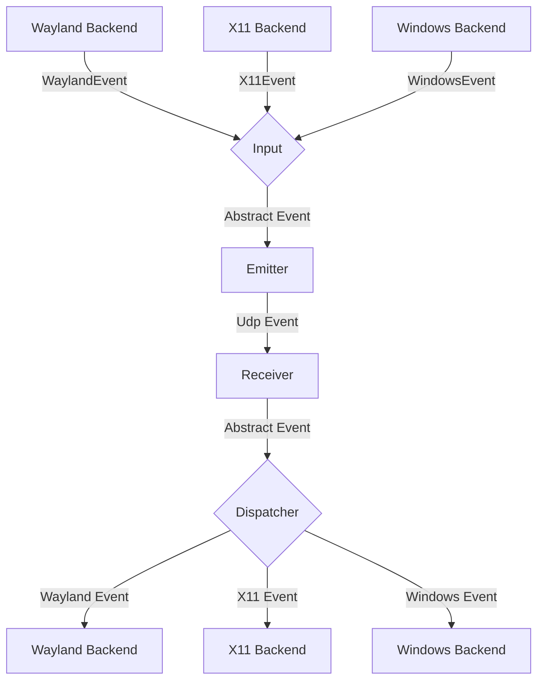
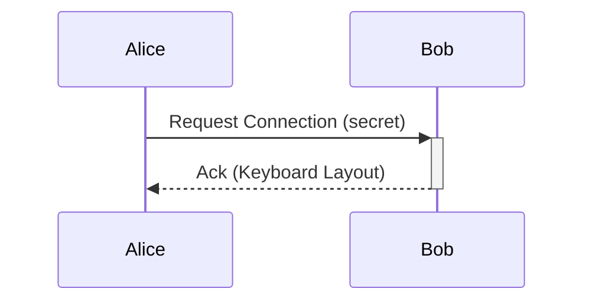

# General Software Architecture

## Events

Each instance of lan-mouse can emit and receive events, where
an event is either a mouse or keyboard event for now.

The general Architecture is shown in the following flow chart:

### Input
The input component is responsible for translating inputs from a given backend
to a standardized format and passing them to the event emitter.

### Emitter
The event emitter serializes events and sends them over the network
to the correct client.

### Receiver
The receiver receives events over the network and deserializes them into
the standardized event format.

### Dispatcher
The dispatcher component takes events from the event receiver and passes them
to the correct backend corresponding to the type of client.

## Requests

// TODO this currently works differently

Aside from events, requests can be sent via a simple protocol.
For this, a simple tcp server is listening on the same port as the udp
event receiver and accepts requests for connecting to a device or to
request the keymap of a device.

## Problems
The general Idea is to have a bidirectional connection by default, meaning
any connected device can not only receive events but also send events back.

This way when connecting e.g. a PC to a Laptop, either device can be used
to control the other.

It needs to be ensured, that whenever a device is controlled the controlled
device does not transmit the events back to the original sender.
Otherwise events are multiplied and either one of the instances crashes.

To keep the implementation of input backends simple this needs to be handled
on the server level.

## Device State - Active and Inactive
To solve this problem, each device can be in exactly two states:

Either events are sent or received.

This ensures that
- a) Events can never result in a feedback loop.
- b) As soon as a virtual input enters another client, lan-mouse will stop receiving events,
which ensures clients can only be controlled directly and not indirectly through other clients.

## Clipboard sync

Clipboard sync is a separate subsystem in the `lan-mouse-clipboard` crate. It
uses its own TCP/TLS channel on the same port as the UDP input path and runs as
its own task in the service, independent of capture and emulation. See
[CLIPBOARD.md](./CLIPBOARD.md) for the transport, wire protocol, backends and
loop prevention.

On Linux it also supports lazy file and directory copies:

- The sender walks the copied paths (dereferencing symlinks) into an in-memory
  manifest and broadcasts a `FileOffer` before the normal `Announce`.
- The receiver creates an in-memory, read-only FUSE generation for the offer and
  puts local `file://` URIs from that mount on the clipboard.
- A paste reads 1 MiB chunks on demand through a directed broker request; the
  sender serves ranges from the remembered offer with `read_at`.
- If FUSE is unavailable or the offer is rejected, the following `Announce` is
  applied normally, preserving the old same-path behavior.

File offers are tracked by `(origin, serial)`, not by the existing content-hash
loop prevention. The receiver also suppresses the local watcher echo of the URI
list it just set and ignores changes that point back into its own mount.

### Windows

The Windows backend owns one clipboard worker thread with an OLE STA message
loop. Local text, images and `CF_HDROP` file lists are polled through the Win32
clipboard. A received file offer becomes an `IDataObject` with
`CFSTR_FILEDESCRIPTORW`/`CFSTR_FILECONTENTS`; each file is a lazy `IStream` that
requests 1 MiB chunks through the broker. Directory trees use relative
`cFileName` paths and empty directories use directory descriptors. Names that
Windows cannot represent reject the whole offer. Remote URI lists are rejected
rather than converted into local paths; apps that only accept `CF_HDROP` do not
support remote virtual files.
